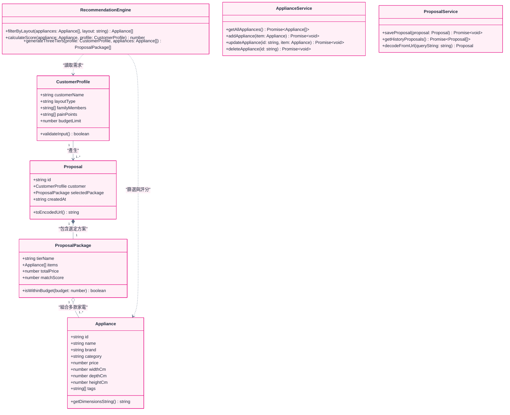
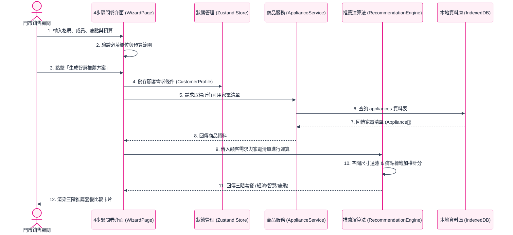
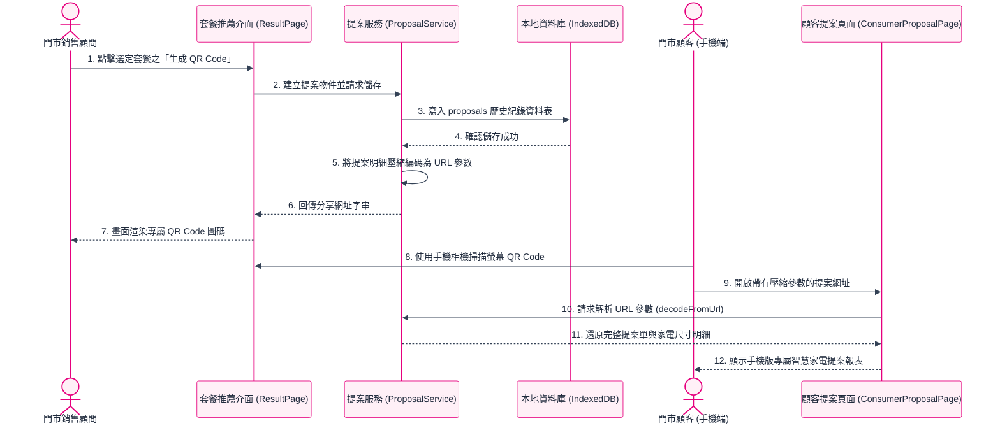
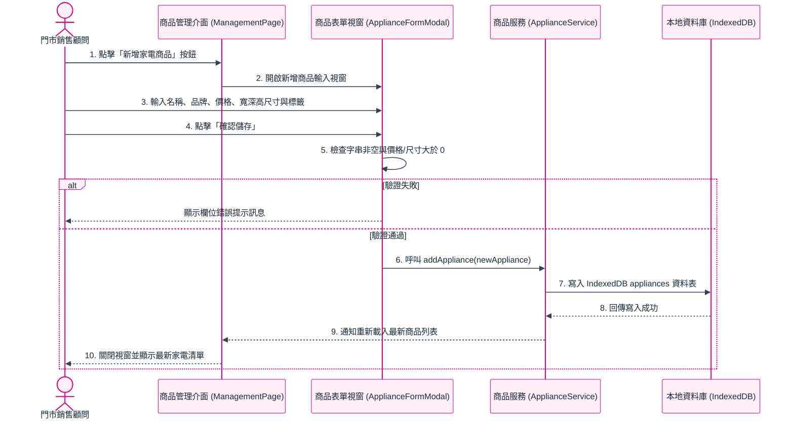
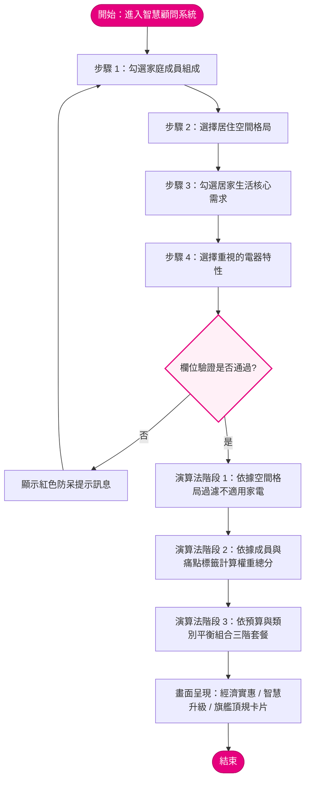
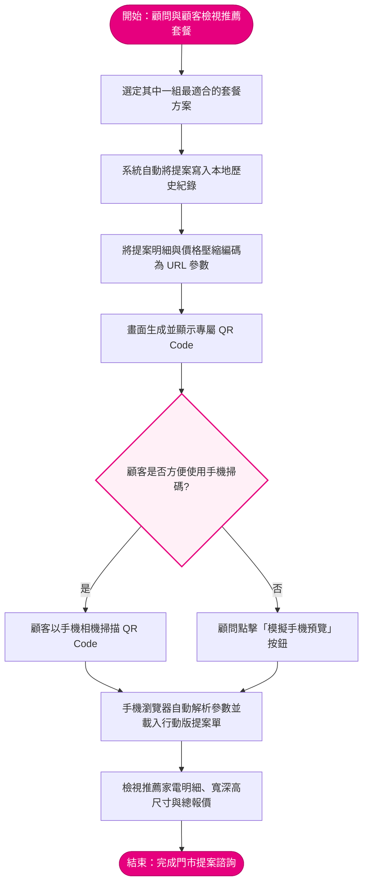
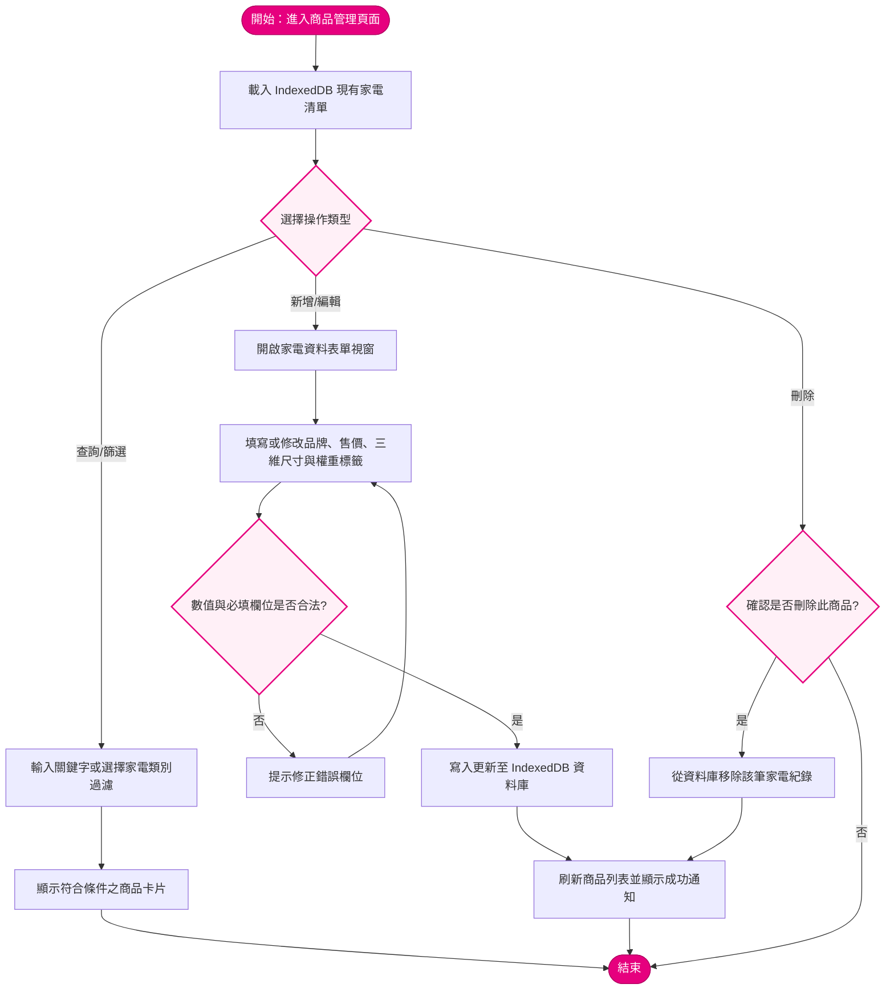

# 作業 4：UML 類別圖、循序圖與活動圖 (hw4.md)

## 一、 UML 類別圖 (Class Diagram)

## 二、 循序圖(Sequence Diagrams)
針對 UC-01：填寫需求問卷與智慧推薦運算

針對 UC-02 & UC-05：生成 QR Code 與顧客手機掃碼檢視

針對 UC-03：家電商品新增與維護 (CRUD)

## 三、 活動圖 (Activity Diagrams)
針對 UC-01：情境導向智慧推薦業務流程

針對 UC-02 & UC-05：B2B2C 跨裝置提案分享流程

針對 UC-03：門市家電商品資料庫維護流程

